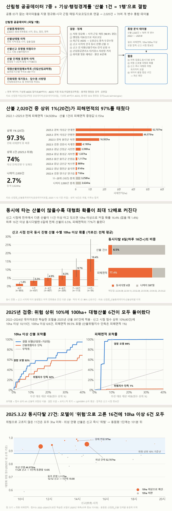
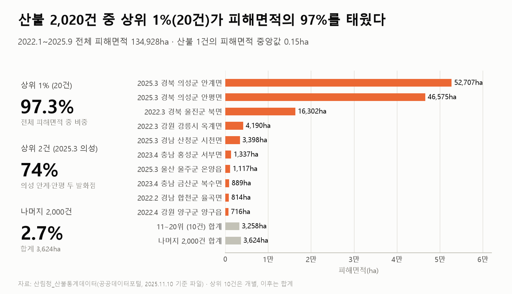
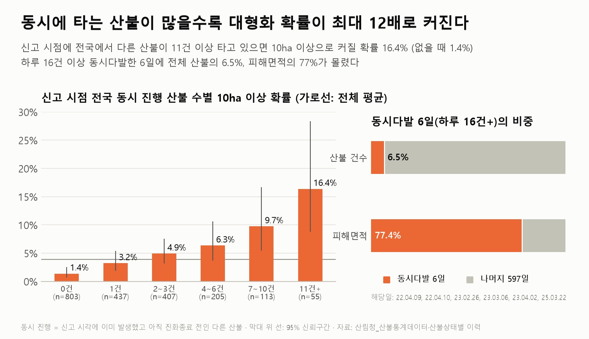
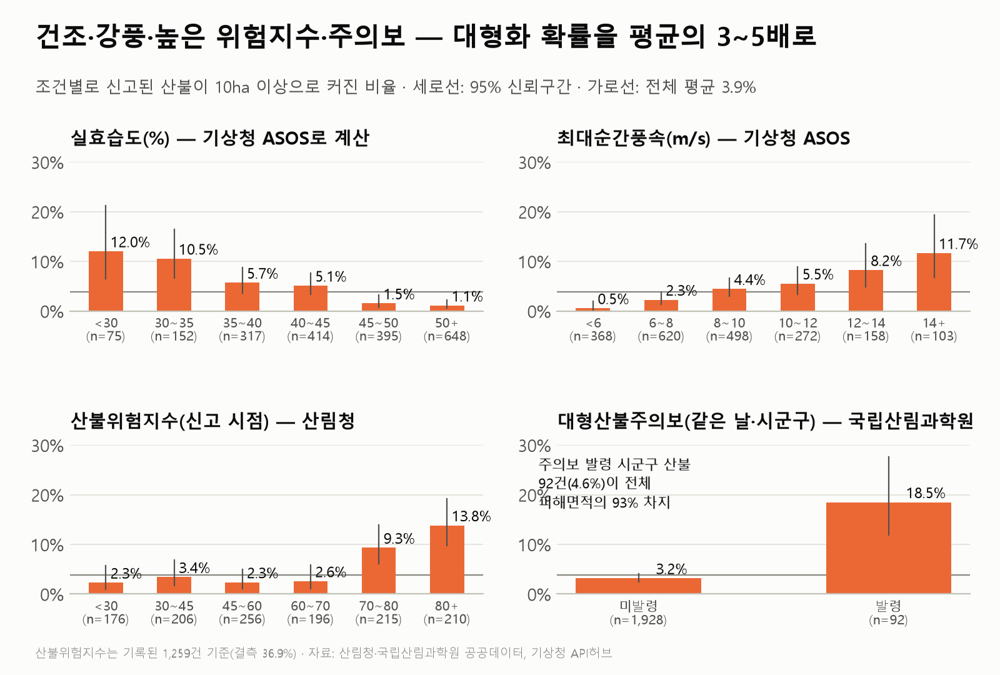
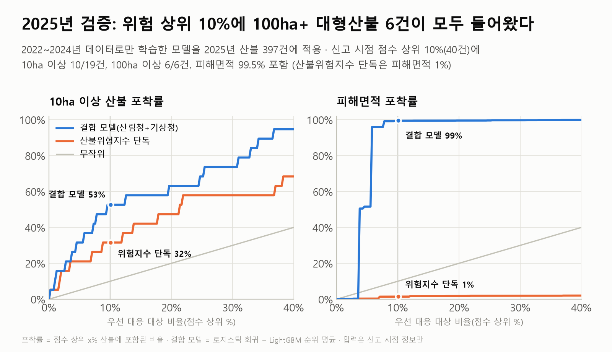
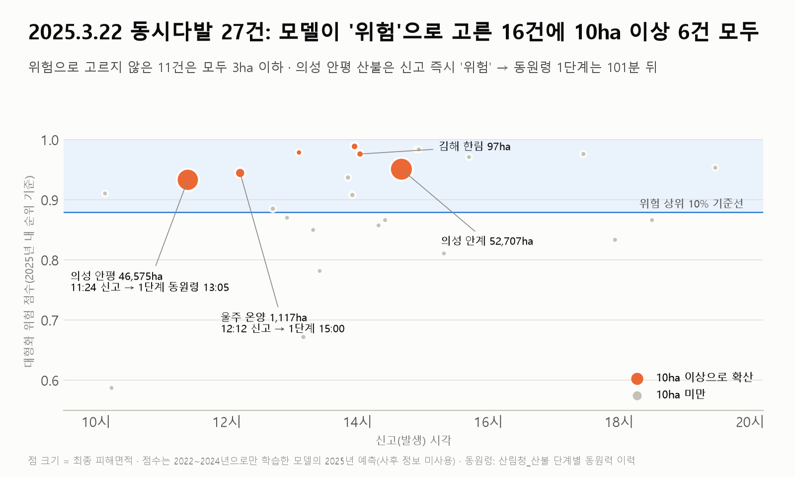
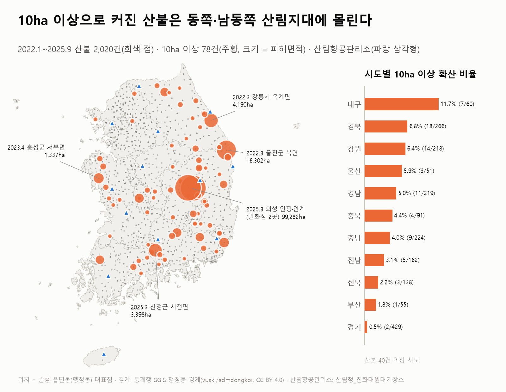
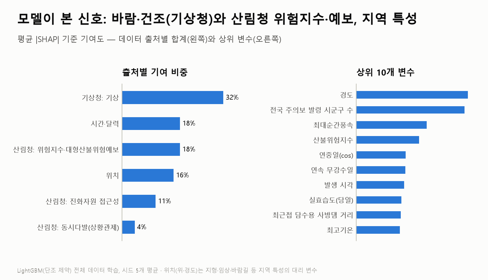
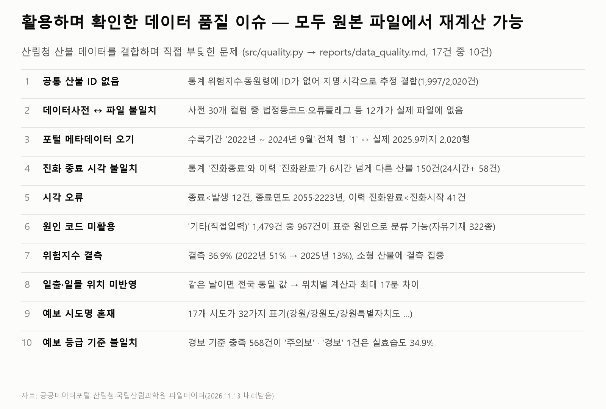

# 산불 골든타임: 신고 즉시 '커질 산불'을 가려내는 트리아지

산림청 공공데이터 산불 7종과 기상청 관측자료를 **산불 1건 = 1행**으로 결합하여 두 가지를 했다. 하나는 대형산불이 어떤 조건에서 나는지에 대한 분석이고, 다른 하나는 신고 시점의 정보만으로 '10ha 이상으로 커질 위험'에 점수를 매기는 트리아지 모델이다.

> 「산림공공데이터 어디까지 써봤니」 활용사례 공모(산림청, 2026) 자체 활용형 출품작



## 핵심 결과

| | 결과 |
|---|---|
| 피해 집중 | 2022.1~2025.9 산불 **2,020건 중 상위 1%(20건)가 피해면적의 97.3%** (전체 134,928ha, 1건 중앙값 0.15ha) |
| 동시다발 | 신고 시점에 전국에서 다른 산불이 11건 이상 타고 있으면 10ha 이상으로 커질 확률 **16.4%**. 다른 산불이 없을 때는 1.4%. 하루 16건 이상 난 6일에 산불은 6.5%였지만 **피해면적은 77%** |
| 대형산불주의보 | 같은 날 주의보가 발령된 시군구에서 난 산불 92건(4.6%)이 **피해면적의 93%** (10ha 이상 확률 18.5% vs 3.2%) |
| 트리아지 모델 | 2022~2024년 데이터로만 학습하고 2025년 397건에 적용. **점수 상위 10%(40건)에 100ha 이상 대형산불 6건이 모두** 들어왔고 피해면적의 99.5%를 포함 (AUC 0.84). 산불위험지수 하나로 고른 상위 10%에는 피해면적의 1%만 포함 |
| 골든타임 | 동원령이 발령된 산불 60건 중 모델이 신고 시점에 상위 10%로 짚은 27건은, 실제 첫 동원령이 신고 후 **중앙값 105분** 뒤였다(3단계는 220분 뒤). 그만큼 먼저 대비할 시간이 생긴다는 뜻 |
| 2025.3.22 사례 | 27건이 동시다발한 날, 모델이 '위험'으로 고른 16건에 10ha 이상 6건(의성 안평·안계·금성, 울주 온양, 김해 한림, 경산 남천)이 모두 포함 |
| 데이터 품질 | 활용 중 품질 이슈 **17건**을 정리했다(공통 ID 부재, 데이터사전↔파일 불일치, 시각 오류, 예보 등급 기준 불일치 등). 모두 원본에서 재계산 가능 → [reports/data_quality.md](reports/data_quality.md) |

## 데이터

| 구분 | 데이터 (공공데이터포털 ID) | 규모 | 쓰임 |
|---|---|---|---|
| 산림청 | [산림청_산불통계데이터](https://www.data.go.kr/data/15121380/fileData.do) (15121380) | 2,020건, 2022.1~2025.9 | 발생·진화종료 시각, 장소, 원인, 피해면적 (기준 테이블) |
| 산림청 | [산림청_산불상태별 이력](https://www.data.go.kr/data/15121205/fileData.do) (15121205) | 2,030건 | 진화 시작·완료 시각, 정식 주소, 산불정보아이디 |
| 산림청 | [산림청_산불상황관제시스템 산불신고 유형별 위험지수](https://www.data.go.kr/data/15121208/fileData.do) (15121208) | 2,020건 | 신고 시점 산불위험지수 |
| 산림청 | [산림청_산불상황관제시스템 산불 단계별 동원력 이력](https://www.data.go.kr/data/15121381/fileData.do) (15121381) | 60건 | 동원령 1~3단계 발령 시각 (골든타임 비교 기준) |
| 국립산림과학원 | [대형산불위험예보목록정보](https://www.data.go.kr/data/15092027/fileData.do) (15092027) | 49,117건, 2017~2026 | 읍면동·시간별 대형산불주의보 |
| 산림청 | [산불상황관제시스템_진화대원대기장소](https://www.data.go.kr/data/15144788/fileData.do) (15144788) | 90곳 | 산림항공관리소·대기장소 위치 → 거리 |
| 산림청 | [산불상황관제시스템_담수용사방댐](https://www.data.go.kr/data/15144784/fileData.do) (15144784) | 43곳 | 헬기 담수원 위치 → 거리 |
| 연계 | 기상청 API허브 지상관측(ASOS) 일자료 | 2021.11~2025.11, 전 지점 | 실효습도·최대순간풍속·무강수일 |
| 연계 | [국립환경과학원_기상청측정소 정보](https://www.data.go.kr/data/15150429/fileData.do) (15150429) | ASOS 지점 | 지점 위경도 |
| 연계 | 통계청 SGIS 행정동 경계 ([vuski/admdongkor](https://github.com/vuski/admdongkor), 2025.4.1) | 3,554개 | 읍면동 대표점 지오코딩, 지도 |

공공데이터포털 파일 8종(산림청 7종 + 국립환경과학원 1종)은 모두 '이용허락범위 제한 없음'이다(2026.11.13 확인). 기상청 자료와 행정동 경계는 출처를 표시해 사용했다. 행정동 경계에는 공공누리 제1유형과 CC BY 4.0이 적용된다.

## 방법

1. **결합.** 산불통계에는 공통 ID와 행정코드가 없고 지명이 약칭(`경북/봉화/명호`)으로 적혀 있다. 그래서 상태별 이력의 정식 주소(`경상북도 봉화군 명호면`)와 지명 어간을 맞추고, 같은 날(±1일) 후보 중 발생 시각과 진화 시작 시각이 가까운 것을 1:1로 매칭했다(1,997/2,020건, 98.9%). 위험지수와 동원령은 이력과 주소 표기가 같아 (일자, 주소, 순번)으로 붙였다.
2. **위치.** 행정동 경계의 대표점으로 읍면동을 지오코딩했다(1,726건은 읍면동, 294건은 시군구 단위). 2023년 경북에서 대구로 편입된 군위군, 시군구가 없는 세종시는 따로 보정했다.
3. **변수(모두 신고 시점에 알 수 있는 정보).**
   - 기상: 최근접 ASOS의 실효습도(He = 0.3·Σ0.7ⁿHₙ), 최대순간풍속, 최소습도, 연속 무강수일
   - 산림청 위험지수와 대형산불위험예보: 신고 전까지 해당 시군구의 주의보 발령 여부, 전국 주의보 시군구 수
   - 상황관제: 신고 시각에 전국·시도에서 진행 중인 다른 산불 수
   - 진화자원: 최근접 산림항공관리소·진화대 대기장소·담수용 사방댐까지 거리
   - 달력: 위치별로 다시 계산한 일몰까지 남은 시간, 공휴일
   - 원인, 진화시간, 동원령처럼 **사후에 정해지는 정보는 넣지 않았다.**
4. **모델.** 로지스틱 회귀와 LightGBM(물리적으로 방향이 분명한 변수에는 단조 제약)의 순위를 평균했다. 목표는 '피해면적 10ha 이상'(78건, 3.9%).
5. **검증.**
   - 연도 교차검증(한 해를 통째로 빼고 학습한 뒤 그 해를 예측)
   - 시간 외 검증(2022~2024 → 2025)
   - 단일 지표(산불위험지수, 주의보, 실효습도, 풍속, 동시 산불 수)와 비교
   - 데이터를 단계별로 더해 가며 성능 변화 확인

| 연도 교차검증 (전체 2,020건) | AUC | 상위 10%가 포착한 10ha+ | 100ha+ | 피해면적 |
|---|---|---|---|---|
| 산불위험지수 단독 | 0.675 | 26.9% | 36.0% | 4.6% |
| 실효습도 단독 | 0.729 | 26.9% | 24.0% | 5.9% |
| ① 산림청 데이터만 결합 | 0.756 | 28.2% | 36.0% | 53.3% |
| ② + 기상청 기상 | 0.783 | 41.0% | 64.0% | 95.3% |
| ③ + 위치 (최종) | 0.774 | 39.7% | 64.0% | 94.9% |

| 시간 외 검증 (2025년 397건) | AUC | 상위 10%가 포착한 10ha+ | 100ha+ | 피해면적 |
|---|---|---|---|---|
| 산불위험지수 단독 | 0.669 | 31.0% | 33.3% | 1.4% |
| 최대풍속 단독 | 0.742 | 47.4% | 83.3% | 98.3% |
| **결합 모델 (최종)** | **0.838** | **52.6%** | **100%** | **99.5%** |

## 그림

| | |
|---|---|
|  |  |
|  |  |
|  |  |
|  |  |

## 한계

- 이 결과는 과거 자료로 한 사후 검증이다. 운영에 쓰려면 당일 기상 관측값 대신 기상청 단기예보를 넣어야 한다.
- 10ha 이상은 78건, 100ha 이상은 25건뿐이라 지표의 불확실성이 크다. 2025년 검증에서 대형산불 6건의 순위는 1~38위로, 상위 10% 경계(40위)에 가까운 건도 있다.
- 놓친 사례도 있다. 연도 교차검증에서 2023.4.2~3 홍성(1,337ha)·금산·함평 산불은 상위 10%에 들지 못했다.
- 진화 착수 지연(발생→진화 시작, 중앙값 26분)은 대형화와 단순한 관계를 보이지 않았다. 큰 불일수록 더 빨리 대응하는 역인과가 섞여 있기 때문이다. 헬기 출동·도착 시각이 없어 초기 대응 효과는 직접 측정할 수 없었다(→ 개선 제안).
- 위치(위·경도)는 지형·임상·바람길 같은 지역 특성의 대리 변수다. 인과적 의미로 해석하면 안 된다.

## 재현

```bash
python -m venv .venv && .venv\Scripts\activate     # macOS/Linux: source .venv/bin/activate
pip install -r requirements.txt
set KMA_AUTHKEY=...                                 # 기상청 API허브 키 (또는 ~/.kma_authkey 파일)

python src/download.py    # 공공데이터포털 파일 8종 + 기상청 ASOS 일자료 + 행정동 경계
python src/build.py       # 결합 → data/processed/fires.csv (2,020행)
python src/model.py       # 검증·SHAP·동원령 선행시간·동시다발일 시뮬레이션
python src/quality.py     # 데이터 품질 점검 → reports/data_quality.md
python src/figures.py     # figures/*.png
```

```
src/
├─ config.py    경로·데이터셋 ID
├─ download.py  공공데이터포털 파일 다운로드(로그인 불필요한 원문파일), 기상청 API허브, 행정동 경계
├─ load.py      데이터셋별 읽기·정제(지명 정규화, 원인 표준화)
├─ build.py     결합·지오코딩·기상·예보·동시다발 변수 → fires.csv
├─ model.py     트리아지 모델과 검증
├─ quality.py   데이터 품질 점검 17항목
└─ figures.py   제출용 그림
data/processed/  결합 테이블·예측값·지표 (원본 data/raw는 저장소에 포함하지 않음)
reports/         데이터 품질 점검표
figures/         그림
SUBMISSION.md    공모 신청서 문항별 답안
```
